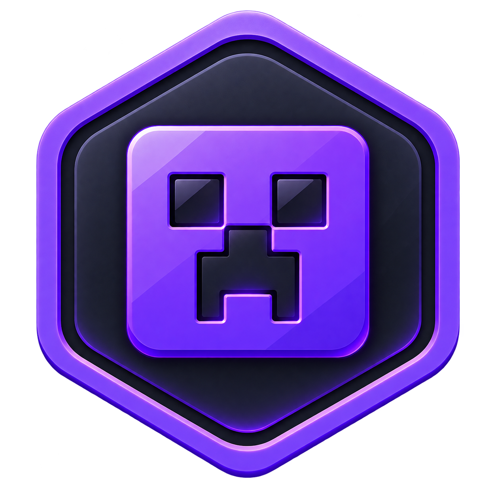

<p align="center">
  
</p>

<h1 align="center">Bedrock Nexus</h1>

<p align="center">
  <a href="README.en.md">English</a> · <a href="README.zh-CN.md">简体中文</a> · <b>فارسی</b>
</p>

<p align="center">
  یک لانچر دسکتاپ مدرن، رایگان و متن‌باز برای <b>Minecraft Bedrock Edition (GDK)</b> در ویندوز.
</p>

<p align="center">
  
  
</p>

---

## ✨ ویژگی‌ها

- **مدیریت اینستنس‌ها** — نصب، ایزوله‌سازی و اجرای هم‌زمان چند بیلد Release و Preview در کنار هم، هرکدام با محتوا و تنظیمات مخصوص خودشان.
- **اجرای تک‌کلیکی** — لانچر هنگام اجرا Microsoft Gaming Services، ‏Microsoft GameInput، ران‌تایم Visual C++‎ و ران‌تایم WebView2 را بررسی می‌کند و می‌تواند GameInput و ران‌تایم Visual C++‎ را برایتان نصب کند. اگر Gaming Services نصب نباشد، از شما خواسته می‌شود آن را از Microsoft Store نصب کنید.
- **مدیریت محتوا** — وارد کردن، سازمان‌دهی، انتقال بین اینستنس‌ها و حذف جهان‌ها، ریسورس‌پک‌ها، بهایورپک‌ها و اسکین‌پک‌ها، و پشتیبان‌گیری از جهان‌ها در فایل‌های ‎.mcworld‎؛ کافی است فایل‌های ‎.mcpack‎، ‎.mcaddon‎ و ‎.mcworld‎ را روی صفحه‌ی محتوا (یا مادهای ‎.zip/.dll‎ را روی صفحه‌ی مادها) بکشید و رها کنید تا وارد شوند.
- **مادینگ** — پشتیبانی کامل از [LeviLamina](https://github.com/LiteLDev/LeviLamina) با نصب، به‌روزرسانی و پین‌کردن نسخه برای هر اینستنس، به‌علاوه‌ی مرور و مدیریت پکیج‌های [lip](https://github.com/LiteLDev/lip).
- **یکپارچه‌سازی CurseForge** — جست‌وجو و نصب مستقیم مادهای Bedrock از CurseForge.
- **مارکت‌پلیس کامیونیتی** — مرور و نصب پک‌ها از یک ایندکس کامیونیتی میزبانی‌شده روی GitHub.
- **ابزارهای جهان** — ویرایشگر داخلی ‎level.dat‎ برای ویژگی‌های جهان، و گالری اسکرین‌شات برای هر نسخه.
- **مدیر دانلود** — دانلودهای قابل ازسرگیری با تلاش مجدد خودکار و نمایش زنده‌ی پیشرفت، برای نسخه‌ها، مادها و وابستگی‌های ران‌تایم.
- **زیبا و شخصی** — تم‌های روشن و تیره، رنگ‌های تاکیدی سفارشی، والپیپر، استروک‌های تم‌دار اختیاری، و انیمیشن‌های نرم با یک کلید قطع انیمیشن.
- **واقعاً چندزبانه** — ۱۲ زبان (English، ‏简体中文، ‏繁體中文، ‏Русский، ‏日本語، ‏Deutsch، ‏Español، ‏Français، ‏Italiano، ‏한국어، ‏Português، ‏فارسی) با برابری کامل ترجمه‌ها، و پشتیبانی از متن راست‌به‌چپ برای فارسی (تراز متن RTL، چیدمان آینه‌ای تنظیمات و دسته‌فونت مناسب فارسی).
- **Discord Rich Presence** — وقتی بازی در حال اجراست، نشان دهید چه بازی می‌کنید.
- **به‌روزرسانی خودکار** — لانچر GitHub Releases را برای نسخه‌های جدید بررسی می‌کند و می‌تواند به‌روزرسانی را دانلود و نصب کند و برای اتمام کار، خودش را دوباره اجرا کند. (پس از انتشار ریلیزها فعال می‌شود.)
- **عیب‌یابی و گزارش باگ داخلی** — تولید گزارش عیب‌یابی (نسخه‌ی برنامه و سیستم‌عامل، معماری، و گزیده‌ای از لاگ اجرا با حذف مسیر پروفایل کاربر) و باز کردن ایشوهای از پیش پرشده‌ی GitHub از داخل خود برنامه.

## 📥 دانلودها

هنوز هیچ ریلیز عمومی‌ای منتشر نشده است، پس فعلاً نصب‌کننده‌ای برای دانلود وجود ندارد. می‌توانید Bedrock Nexus را از سورس بسازید — بخش [توسعه](#️-توسعه) در پایین را ببینید. نصب‌کننده‌ها روی [GitHub Releases](https://github.com/BedrockNexusLauncher/BedrockNexusLauncher/releases) منتشر خواهند شد.

## 📋 نیازمندی‌ها

- ویندوز ۱۰ یا ۱۱ (x64)
- یک نسخه‌ی لایسنس‌دار از Minecraft Bedrock Edition (GDK) از Microsoft Store
- ‏Microsoft Gaming Services و Microsoft GameInput — لانچر هنگام اجرا این‌ها را بررسی می‌کند؛ می‌تواند GameInput (و ران‌تایم Visual C++‎) را به‌صورت خودکار راه‌اندازی کند، اما Gaming Services اگر نصب نباشد باید از Microsoft Store نصب شود

## 📖 مستندات

- **English:** https://bedrocknexuslauncher.github.io/BedrockNexusLauncher/
- **简体中文:** https://bedrocknexuslauncher.github.io/BedrockNexusLauncher/zh-CN/
- **繁體中文:** https://bedrocknexuslauncher.github.io/BedrockNexusLauncher/zh-HK/
- **Español:** https://bedrocknexuslauncher.github.io/BedrockNexusLauncher/es-ES/
- **Русский:** https://bedrocknexuslauncher.github.io/BedrockNexusLauncher/ru-RU/
- **Deutsch:** https://bedrocknexuslauncher.github.io/BedrockNexusLauncher/de-DE/
- **日本語:** https://bedrocknexuslauncher.github.io/BedrockNexusLauncher/ja-JP/
- **한국어:** https://bedrocknexuslauncher.github.io/BedrockNexusLauncher/ko-KR/
- **Français:** https://bedrocknexuslauncher.github.io/BedrockNexusLauncher/fr-FR/

## 💬 کامیونیتی

- **Discord:** https://discord.gg/v5R5P4vRZk
- **QQ Group:** https://qm.qq.com/q/1z791rJgJG

## 🐛 گزارش مشکلات

باگی پیدا کردید یا ایده‌ای برای یک قابلیت جدید دارید؟ لطفاً [یک ایشو باز کنید](https://github.com/BedrockNexusLauncher/BedrockNexusLauncher/issues).
سریع‌ترین راه، گزینه‌ی **تنظیمات ← گزارش مشکل** (یا **درباره ← گزارش مشکل**) داخل لانچر است — گزارش عیب‌یابی (با حذف مسیر پروفایل کاربر) به‌صورت خودکار ضمیمه می‌شود.

## 🛠️ توسعه

Bedrock Nexus در بک‌اند با [Go](https://go.dev) و [Wails v3](https://v3alpha.wails.io) و در فرانت‌اند با React 19، ‏TypeScript، ‏Tailwind CSS 4 و HeroUI ساخته شده است.

### پیش‌نیازها

- [Go](https://go.dev/dl/) نسخه‌ی ۱.۲۵.۳ یا جدیدتر
- [Node.js](https://nodejs.org) نسخه‌ی ۲۰ یا جدیدتر (npm)
- [Wails v3 CLI](https://v3alpha.wails.io/reference/cli): ‏`go install github.com/wailsapp/wails/v3/cmd/wails3@latest`
- [Task](https://taskfile.dev): ‏`go install github.com/go-task/task/v3/cmd/task@latest`

### کلید API ‏CurseForge

قابلیت‌های CurseForge هنگام اجرا به یک کلید API نیاز دارند. متغیر محیطی `CURSEFORGE_API_KEY` را تنظیم کنید، یا هنگام بیلد ریلیز کلید را تزریق کنید: ‏`go build -ldflags "-X main.curseForgeAPIKeyBuild=<key>"`. هرگز کلیدی را در ریپازیتوری کامیت نکنید.

### اجرا و بیلد

```bash
# نصب وابستگی‌های فرانت‌اند
cd frontend && npm install && cd ..

# اجرای برنامه در حالت توسعه (هات ریلود)
wails3 task dev

# بیلد نهایی
wails3 task build

# ساخت نصب‌کننده (Inno Setup)
wails3 task package:inno

# تایپ‌چک و اعتبارسنجی فرانت‌اند
wails3 task verify
```

### سایت مستندات

راهنمای کاربر یک سایت VitePress در [‎docs/‎](docs/) است:

```bash
cd docs
npm install
npm run docs:dev
```

## 🤝 مشارکت

از پول‌ریکوئست‌ها استقبال می‌شود! برای تغییرات اساسی، لطفاً اول یک ایشو باز کنید تا درباره‌ی تغییری که می‌خواهید بدهید گفت‌وگو کنیم، و از سبک کدنویسی موجود پیروی کنید (بک‌اند زیر ‎internal/‎ و فرانت‌اند زیر ‎frontend/src/‎ گروه‌بندی شده‌اند).

## 📄 مجوز

این پروژه تحت **مجوز GNU General Public License v3.0 only (GPL-3.0-only)** منتشر شده است — متن کامل را در [COPYING](COPYING) ببینید.

Bedrock Nexus فورکی از [LiteLDev/LeviLauncher](https://github.com/LiteLDev/LeviLauncher) است که آن هم تحت GPL-3.0-only منتشر شده است. کامپوننت‌های همراه در [THIRD_PARTY_NOTICES](THIRD_PARTY_NOTICES) فهرست شده‌اند و هرجا در آن فایل ذکر شده باشد، تحت شرایط خودشان باقی می‌مانند.

## ⚠️ سلب مسئولیت

Bedrock Nexus یک لانچر کامیونیتی غیررسمی است و با Mojang Studios یا Microsoft وابستگی، تأیید یا ارتباطی ندارد. برای استفاده از آن باید یک نسخه‌ی قانونی و لایسنس‌دار از Minecraft Bedrock Edition داشته باشید. «Minecraft» علامت تجاری Mojang Studios است.
